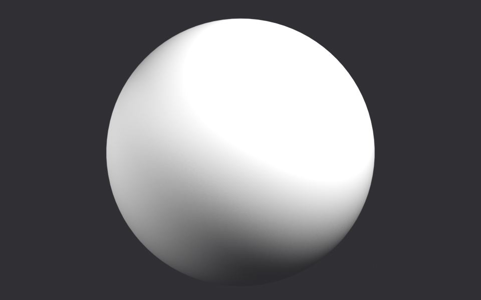

# Blender Texture GUI — Week 5 bridge assignment

**App:** Blender 5.2 LTS
**Way:** **A port.** A small TCP server runs *inside the open Blender window*
(not a headless `--background` command) and executes Python on Blender's main
thread. The agent sends commands to `127.0.0.1:7788` and you watch the scene
change live. (An MCP wrapper is included in `bridge/` too, but the port is the
primary method.)

The "one thing" I asked the agent for was an **artist-friendly Texture GUI
inside Blender** — an add-on with a panel of sliders that puts an imported image
onto the selected object as an art-directable material. The agent built the
add-on, the bridge, and then ran a several-step job through the bridge: build a
scene, texture a sphere, **render it, check its own render, find a problem, fix
it, and re-render.**



The two renders the agent produced and inspected: `work/demo_pass1.png`
(gray — the texture did not show) and `work/demo_pass2.png` (fixed).

---

## 1. What each piece is

| File | Role |
| --- | --- |
| `bridge/blender_bridge.py` | TCP server that runs **inside Blender**; executes Python on the main thread via `bpy.app.timers`. |
| `bridge/startup.py` | Auto-starts the bridge when Blender launches. |
| `bridge/install.sh` | Copies the two files above into Blender's user scripts. |
| `bridge/mcp_server.py` | Optional MCP stdio server exposing `blender_run` / `blender_status`. |
| `bridge_client.py` | Tiny port client (stdlib only) used by the demo. |
| `texture_gui.py` | The **Texture GUI add-on** the agent wrote (36 controls, 9 surface presets, colour bar, drag-and-drop). |
| `demo_job.py` | The multi-step job the agent runs through the bridge (with self-check + fix). |
| `assets/test_texture.png` | The image the agent textures the object with. |
| `work/demo_pass*.png` | Renders the agent produced and inspected. |

---

## 2. How to run it (Blender 5.2, macOS)

You need Blender installed. Everything else is Python standard library.

### Step 1 — install the bridge into Blender

```sh
cd bridge
./install.sh 5.2          # use your Blender version if different, e.g. ./install.sh 4.2
```

This copies `blender_bridge.py` → `…/Blender/5.2/scripts/modules/` and
`startup.py` → `…/Blender/5.2/scripts/startup/opencode_blender_bridge.py`.

**Restart Blender.** On launch it prints:

```
blender-bridge listening on 127.0.0.1:7788
```

(If you'd rather not restart, open Blender's **Scripting** workspace and run
`import blender_bridge; blender_bridge.start()`.)

### Step 2 — install the Texture GUI add-on

Copy `texture_gui.py` into Blender's add-ons folder:

```sh
cp texture_gui.py "$HOME/Library/Application Support/Blender/5.2/scripts/addons/"
```

then in Blender: **Edit ▸ Preferences ▸ Add-ons**, search **Texture GUI**, tick
it on. (Or use **Install…** and pick `texture_gui.py`.) A **Texture GUI** tab
appears in the 3D viewport sidebar (`N`).

### Step 3 — check the bridge answers

```sh
python3 bridge_client.py run "import bpy; print(bpy.app.version_string)"
# -> 5.2.1 LTS
```

### Step 4 — run the job

With Blender open, from this folder:

```sh
python3 demo_job.py
```

Watch Blender: the sphere is created, the material is built, and two renders are
written to `work/`. The terminal prints every step and the self-check numbers.

> Optional MCP instead of the port: add `bridge/mcp_server.py` to your agent
> config (`bridge/opencode.jsonc.example`) and call `blender_run` /
> `blender_status`. Same server underneath.

---

## 3. What I asked for (exact words) and what happened

These are the prompts I gave the agent, verbatim, in the sessions that produced
this:

1. **"open blender"** → the agent launched the Blender GUI and confirmed the
   bridge answered on port 7788.
2. **"the gui is not responding to the image being applied to the object. fix it."**
   → the agent found the viewport was in **Solid** shading (which ignores node
   textures) and made the add-on switch the viewport to **Material Preview** on
   apply.
3. **"for that same gui, get rid of the style section and add more features and
   sliders to edit textures and the imported image. for the hue slider, add a
   color bar so we can see where the hue is sliding to. add in other features and
   sliders that would help artist."** → the agent removed the style presets and
   rebuilt the add-on around colour/UV/surface sliders plus a hue colour bar.
4. **"the drag and drop image function is not working and the import image button
   is redundant because open image button is there, remove the import button
   section."** → the agent implemented real OS drag-and-drop with Blender's
   `FileHandler` API and deleted the redundant import button.
5. **"now make the gui better is any way possible also add more surface sliders
   and options to customize"** → the agent reorganised the panel into collapsible
   sections, added 9 surface presets and 12 more surface controls (coat, sheen,
   anisotropy, subsurface, transmission, alpha, IOR, specular, procedural bump
   detail…), and made stale materials auto-rebuild.

Then, for the graded "job":

> **"Put my test image on the sphere as an art-directed material and render it
> so I can see it."**

---

## 4. The job the agent runs (and how it checks itself)

`demo_job.py` performs the request in several steps, all through the bridge, in
the open app:

1. Reset the scene; add a UV sphere, two area lights, a camera, a dark world;
   set EEVEE at 960×600.
2. Load `assets/test_texture.png` into the **Texture GUI**.
3. Art-direct it: `hue=0.05 saturation=1.2 contrast=1.1 relief=0.6 depth=0.45
   roughness=0.4 metallic=0.1`.
4. **Render pass 1** → `work/demo_pass1.png`.
5. **Self-check:** read the rendered pixels in Blender (numpy) and measure mean
   saturation and luminance. Pass 1 reports **mean saturation 0.050** — the
   render is grey. **Problem detected.**
6. **Diagnose + fix:** the material was applied to `context.active_object`, which
   after adding the camera was the **camera**, not the mesh — so nothing was
   built on the sphere. The agent selects the sphere and re-applies.
7. **Render pass 2** → `work/demo_pass2.png`, self-check again.
8. **Result:** mean saturation **0.050 → 0.213**, texture now visible.

Actual terminal output of the fix step:

```
=== STEP 5 - self-check the rendered pixels ===
PROBLEM: render is nearly colourless (mean saturation 0.050).
The texture is not showing on the sphere.

=== STEP 6 - diagnose and fix ===
Diagnosis: the image/material was applied to bpy.context.active_object,
which was the camera - so nothing was built on the mesh.
active object now: TextureDemo | material slots: ['TextureGUI'] | nodes: 22

=== STEP 7 - render pass 2 ===
pass 2 stats: {'mean_sat': 0.213, 'mean_lum': 0.2236, ...}

=== RESULT ===
mean saturation 0.050 -> 0.213
fixed: True
```

This is the assignment's "check its own result (a render) and fix what's wrong"
— the agent inspected its own render, found the texture wasn't showing, worked
out why, fixed it, and confirmed the fix with a second render.

---

## 5. The add-on itself (Texture GUI, v1.2.0)

* Sidebar panel **View3D ▸ N ▸ Texture GUI**, collapsible sections, plus a
  floating-window version.
* **Image:** pick or drag-and-drop a file straight into the viewport.
* **Colour:** invert, desaturate, amount, hue (with a **hue colour bar**),
  saturation, brightness, contrast, gamma, temperature, tint, posterize.
* **Transform:** scale, rotation, offset, flip.
* **Surface:** relief, depth, invert-relief, procedural detail, roughness,
  metallic, specular, IOR.
* **Surface — Advanced:** coat, coat roughness, sheen, sheen roughness,
  anisotropy, subsurface, transmission, alpha.
* **Emission:** glow strength + glow tint.
* **Presets:** Matte, Glossy, Plastic, Ceramic, Metal, Brushed, Velvet, Glass,
  Glowing.
* Separate **Reset** for colour / transform / surface / everything.

---

## 6. Recording

**Not included.** The 60-second screen recording was not captured because this
machine's terminal did not have macOS Screen Recording permission, and granting
it requires restarting the terminal that was running the session.

To produce it in one command (whole main display, terminal + Blender side by
side):

```sh
cd pfa_week_5 && ./record_and_run.sh 45     # -> recording.mov
```

See `RECORDING.md` for the 60-second shot list. `record.sh` records only and you
run `python3 demo_job.py` yourself.

---

## 7. Repo layout

```
pfa_week_5/
├─ README.md
├─ RECORDING.md
├─ texture_gui.py          # the add-on the agent wrote
├─ demo_job.py             # the multi-step job + self-check + fix
├─ bridge_client.py        # port client (stdlib only)
├─ bridge/                 # the port / MCP bridge (also at github.com/ikao1/blender-bridge)
├─ record.sh               # records the screen (whole display)
├─ record_and_run.sh       # records + runs the job in one command
├─ assets/test_texture.png
└─ work/                   # renders + the agent's earlier style/relief proofs
```
